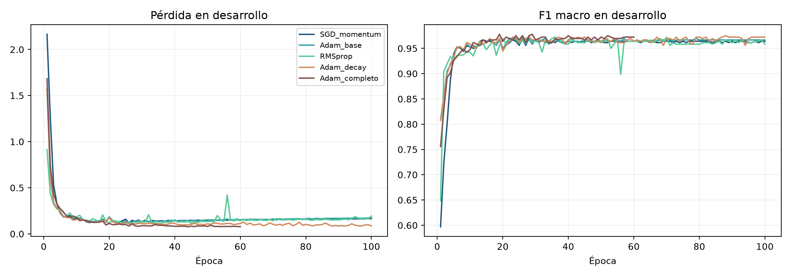
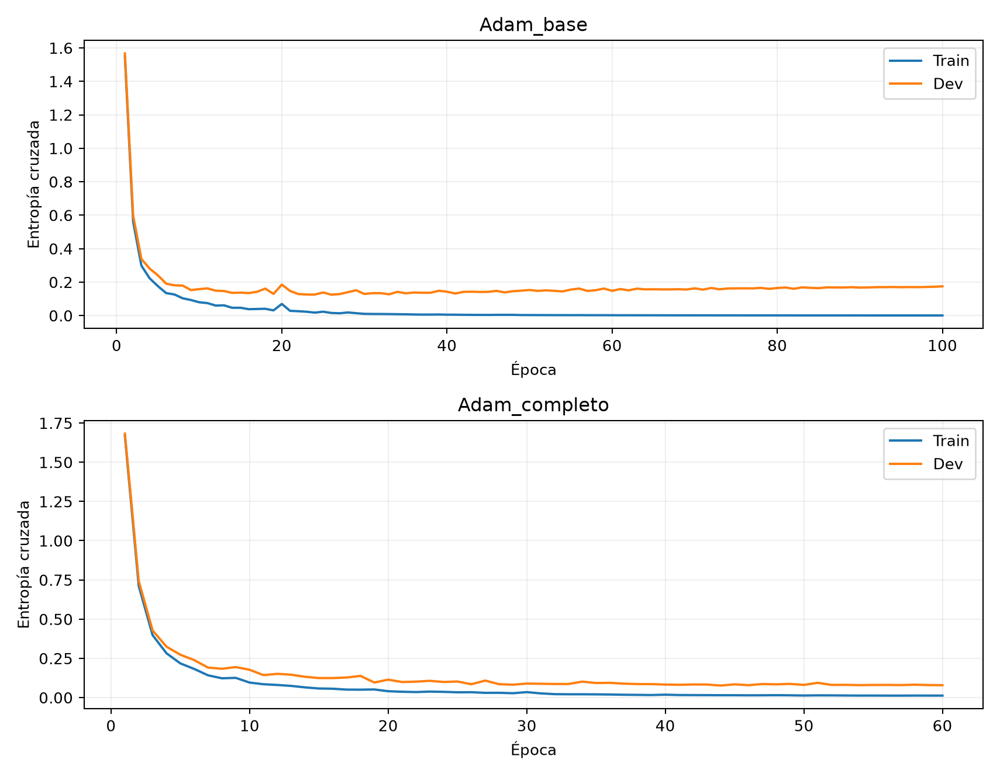
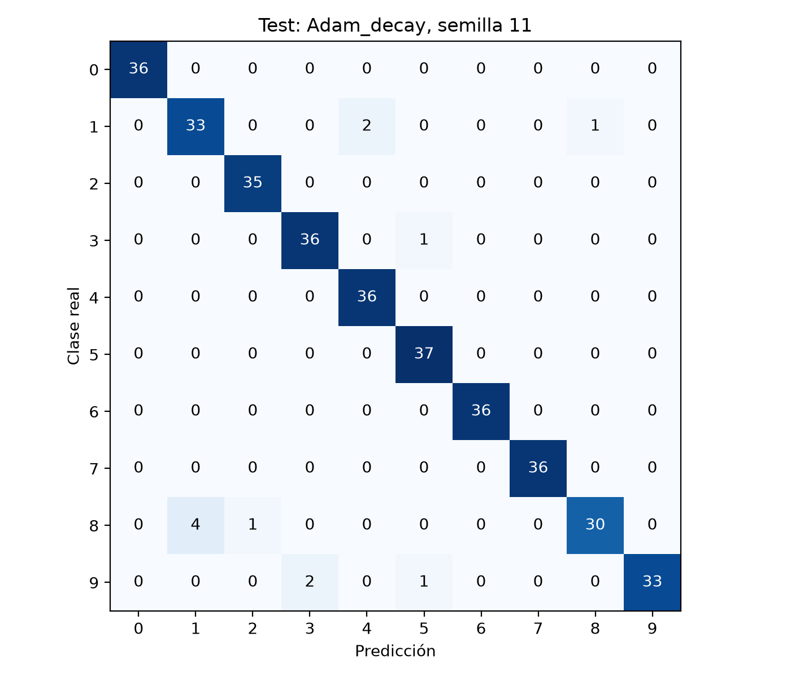
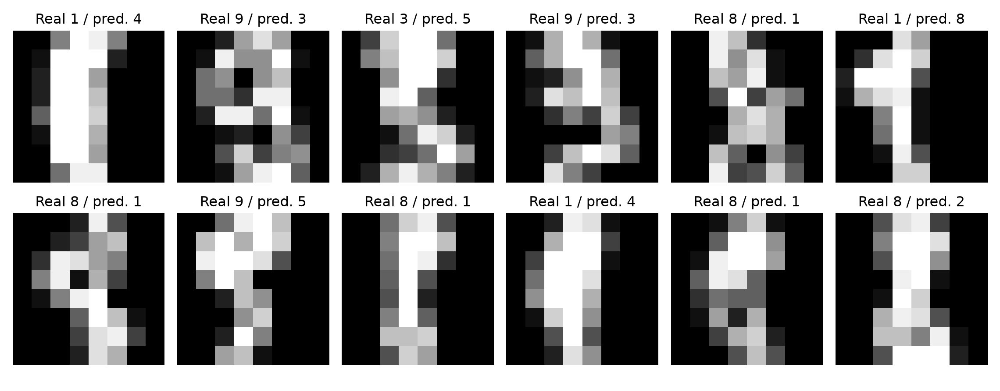

# Reconocimiento de Dígitos Manuscritos con Perceptrón Multicapa: Dinámicas de Optimización, Regularización y Generalización

[](https://www.python.org/)
[](https://pytorch.org/)
[](https://scikit-learn.org/)
[](https://opensource.org/licenses/MIT)

> **Materia:** 608142 – Deep Learning - Conceptos  
> **Actividad:** R1-A3-S7 -- Redes Neuronales III (Moodle ID: `73333`)  
> **Autora:** Karen Sofía Delgado Calderon  
> **Programa:** Especialización en Inteligencia Artificial – Universidad de Cundinamarca  
> **Fecha de entrega:** Sábado, 10 de octubre de 2026, 23:59  

---

## 1. Resumen y Planteamiento del Problema

Esta investigación aborda la clasificación multiclase de caracteres numéricos manuscritos mediante redes neuronales densas (*Multilayer Perceptron*, MLP) sobre el conjunto de datos de referencia **Optical Recognition of Handwritten Digits** (1797 mapas de bits normalizados de $8 \times 8$ píxeles, 10 clases correspondientes a los dígitos del 0 al 9; Alpaydin & Kaynak, 1998; Pedregosa et al., 2011).

### Objetivos y Enfoque Metodológico
1. **Aislamiento de la dinámica de optimización:** Si bien las arquitecturas convolucionales constituyen el paradigma estándar para procesamiento de imágenes (LeCun et al., 1998), evaluar un modelo MLP ($64 \to 128 \to 64 \to 10$) sobre vectores aplanados permite estudiar el comportamiento puro de algoritmos de gradiente y técnicas de regularización sin el sesgo inductivo espacial de los núcleos convolucionales.
2. **Preprocesamiento determinista sin fuga (*Data Leakage*):** Las intensidades de píxel oscilan en el intervalo entero $[0, 16]$. La normalización mediante división analítica exacta $x / 16.0$ responde al límite físico intrínseco del hardware del escáner y no a estimadores muestrales. Esto asegura ausencia absoluta de fuga de información entre particiones.
3. **Diseño experimental trifásico:** Segmentación estratificada en $60\%$ entrenamiento (1077 instancias), $20\%$ desarrollo (360 instancias) y $20\%$ prueba ciega e inmutable (360 instancias).

---

## 2. Marco Teórico y Ecuaciones de Optimización

Se compararon de forma sistemática tres familias algorítmicas bajo condiciones controladas:
* **SGD con Momento Clásico (Polyak, 1964; Bottou, 2010):** Tasa $\eta=0.060$, coeficiente de momento $\beta=0.9$, amortiguando oscilaciones transversales en desfiladeros de pérdida:
  $$v_t = \beta v_{t-1} + \eta \nabla_\theta \mathcal{L}(\theta_{t-1}), \quad \theta_t = \theta_{t-1} - v_t$$
* **RMSprop (Tieleman & Hinton, 2012):** Tasa $\eta=0.0015$, que normaliza los gradientes por la raíz de la media móvil exponencial de los cuadrados de gradientes históricos.
* **Adam Adaptativo (Kingma & Ba, 2015):** Tasa $\eta=0.0030$, sintetizando momentos de primer ($\hat{m}_t$) y segundo ($\hat{v}_t$) orden con corrección de sesgo para dar pasos adaptativos según la curvatura local:
  $$\theta_t = \theta_{t-1} - \frac{\eta}{\sqrt{\hat{v}_t} + \epsilon} \hat{m}_t$$

### Esquemas de Regularización y Manejo de Capacidad
Con 17,226 parámetros entrenables frente a 1077 ejemplos de entrenamiento, la red posee alta capacidad para sobreajustar. Se contrastaron dos políticas principales:
* **Decaimiento de pesos $L_2$ (`Adam_decay`):** Con coeficiente de penalización $\lambda = 0.001$ (Krogh & Hertz, 1991).
* **Política integral (`Adam_completo`):** Regularización compuesta que incorpora *dropout* estocástico ($p = 0.20$; Srivastava et al., 2014) con máscara de Bernoulli, parada temprana (*early stopping*; Prechelt, 1998) con tolerancia de 16 épocas sin mejora en la pérdida de desarrollo, y reducción adaptativa de tasa (`ReduceLROnPlateau`).

---

## 3. Protocolo Experimental y Partición de Datos

| Parámetro Metodológico | Especificación |
| :--- | :--- |
| **Conjunto de datos** | Optical Recognition of Handwritten Digits (1797 imágenes, 64 atributos, 10 dígitos) |
| **Estructura de partición** | Entrenamiento: 1077 (60%), Desarrollo: 360 (20%), Prueba: 360 (20%) |
| **Aislamiento de la prueba** | La partición de prueba permaneció completamente inaccesible durante el entrenamiento |
| **Preprocesamiento** | Escalamiento lineal determinista $x / 16.0$ sin estimadores muestrales |
| **Semillas deterministas** | 11, 23 y 37 (reproducibilidad determinista en PyTorch CPU) |
| **Minilote y épocas** | Minilotes de 64 muestras, tope máximo de 100 épocas |
| **Criterio rector** | Mayor puntuación de $F_1$ macro medio en el conjunto de desarrollo |

---

## 4. Resultados Empíricos en Desarrollo y Selección de Modelo

A continuación se resumen las métricas consolidadas tras promediar las tres ejecuciones deterministas independientes sobre la partición de desarrollo:

| Configuración Algorítmica | $F_1$ macro medio | Desv. Est. (DE) | Pérdida media | Brecha $F_1$ (Train - Dev) |
| :--- | :---: | :---: | :---: | :---: |
| `SGD_momentum` | 0.9641 | 0.0055 | 0.1816 | 0.0359 |
| `Adam_base` | 0.9676 | 0.0016 | 0.1651 | 0.0324 |
| `RMSprop` | 0.9657 | 0.0065 | 0.1631 | 0.0321 |
| **`Adam_decay`** | **0.9714** | **0.0016** | **0.0915** | **0.0286** |
| `Adam_completo` | 0.9705 | 0.0016 | 0.0727 | 0.0280 |

### Hallazgo Crítico de Posgrado: ¿Por qué el Dropout al 20% causó leve Subajuste (*Underfitting*)?
La configuración seleccionada formalmente fue **`Adam_decay`** ($F_1 = 0.9714$). Resulta sumamente instructivo notar que la variante `Adam_completo` obtuvo un $F_1$ ligeramente inferior ($0.9705$):
* En imágenes de baja resolución ($8 \times 8$), los rasgos morfológicos distintivos (como la presencia de un lazo cerrado en un 8 frente a un 1 o la curvatura de un 3 frente a un 9) dependen de combinaciones frágiles de apenas **1 o 2 píxeles activos**.
* Silenciar estocásticamente el 20% de las activaciones mediante *dropout* destruye estas vías de señal sutiles durante el paso hacia adelante, provocando un leve subajuste que perjudica la discriminación fina.
* Por ende, la penalización de norma $L_2$ pura proporcionó la contracción de parámetros idónea sin extinguir la topología de los trazos manuscritos.

---

## 5. Evidencias Gráficas del Experimento

### Trayectorias de Optimización y Convergencia en Desarrollo

*Figura 1: Pérdida y F1 macro en desarrollo para la semilla 11. Los optimizadores adaptativos alcanzan estabilidad antes de la época 30.*

### Brecha de Generalización y Estabilización de Varianza

*Figura 2: Comparación temporal entre la variante base y la configuración regularizada (semilla 11), evidenciando la estabilización del error.*

---

## 6. Evaluación en Prueba y Diagnóstico Cualitativo de Errores

Una vez fijado el modelo óptimo (`Adam_decay`), se evaluó la partición de prueba ciega de 360 imágenes independientes:

| Semilla | Exactitud (*Accuracy*) | Precisión macro | Exhaustividad macro | $F_1$ macro | Pérdida en Prueba |
| :---: | :---: | :---: | :---: | :---: | :---: |
| **11** | 0.9667 | 0.9675 | 0.9663 | 0.9662 | 0.1234 |
| **23** | 0.9667 | 0.9687 | 0.9663 | 0.9665 | 0.1405 |
| **37** | 0.9667 | 0.9674 | 0.9662 | 0.9656 | 0.1123 |

### Matriz de Confusión sobre 360 Muestras de Prueba

*Figura 3: Matriz de contingencia obtenida con el modelo final (`Adam_decay`, semilla 11). La gran mayoría de instancias se sitúan en la diagonal principal.*

### Inspección Visual y Etiología de Errores

*Figura 4: Visualización en resolución nativa de $8 \times 8$ de las 12 imágenes clasificadas incorrectamente (3.33% de error).*

El análisis cualitativo revela que los errores responden a ambigüedades morfológicas intrínsecas a la baja resolución espacial:
* **Dígitos 8 confundidos con 1:** Trazos superiores con intensidad casi nula, asemejándose a una barra vertical.
* **Dígitos 3 clasificados como 9:** Conexiones espurias en la parte superior que cierran visualmente la concavidad del trazo.
* **Dígitos 5 interpretados como 6:** Redondez excesiva en la esquina inferior izquierda.

Esta limitación ratifica por qué los problemas tipográficos de mayor resolución requieren invariancia translacional provista por capas convolucionales (LeCun et al., 1998).

---

## 7. Estructura del Repositorio

```text
karen-redes-neuronales-iii-digitos/
├── README.md                      # Documentación completa y contextualizada del proyecto
├── requirements.txt               # Dependencias reproducibles (PyTorch, scikit-learn, etc.)
├── experimento_redes.py           # Script modular de entrenamiento y evaluación en CPU
├── Karen_Redes.ipynb              # Cuaderno Jupyter con celdas ejecutadas y gráficos embebidos
├── modelo_seleccionado.pt         # Pesos sinápticos serializados del modelo óptimo en PyTorch
├── experimentos_dev.csv           # Registro consolidado de métricas en desarrollo
├── metricas_test.csv              # Registro tabular de evaluación en prueba
├── predicciones_test.csv          # Vector de predicciones finales por semilla
├── resultados.json                # Resumen estructurado en JSON con metadatos del sistema
└── [Figuras PNG]                  # optimizadores.png, regularizacion.png, matriz_test.png, errores_test.png
```

---

## 8. Instrucciones de Replicabilidad

### Opción A: Ejecución Local en CPU
```bash
# 1. Clonar el repositorio
git clone https://github.com/sofiadelcal/karen-redes-neuronales-iii-digitos.git
cd karen-redes-neuronales-iii-digitos

# 2. Instalar requerimientos
pip install -r requirements.txt

# 3. Ejecutar el protocolo experimental
python experimento_redes.py --persona Karen --salida resultados
```

### Opción B: Ejecución en Google Colab
1. Abrir `Karen_Redes.ipynb` directamente en Google Colab.
2. Ejecutar todas las celdas secuencialmente. El cuaderno es autónomo y reproduce las figuras y tablas en la sesión local.

---

## 9. Referencias Bibliográficas (Norma APA 7.ª Edición)

* **Alpaydin, E. y Kaynak, C.** (1998). Cascading classifiers. *Kybernetika*, 34(4), 369–374.
* **Bishop, C. M.** (2006). *Pattern recognition and machine learning*. Springer.
* **Bottou, L.** (2010). Large-scale machine learning with stochastic gradient descent. *COMPSTAT'2010*, 177–186.
* **Goodfellow, I., Bengio, Y. y Courville, A.** (2016). *Deep learning*. MIT Press.
* **Grandini, M., Bagli, E. y Visani, G.** (2020). Metrics for multi-class classification: An overview. *arXiv:2008.05756*.
* **Kingma, D. P. y Ba, J.** (2015). Adam: A method for stochastic optimization. *ICLR 2015*.
* **Krogh, A. y Hertz, J. A.** (1991). A simple weight decay can improve generalization. *NeurIPS 4*, 950–957.
* **LeCun, Y. et al.** (1998). Gradient-based learning applied to document recognition. *Proc. IEEE*, 86(11), 2278–2324.
* **Paszke, A. et al.** (2019). PyTorch: An imperative style, high-performance deep learning library. *NeurIPS 32*.
* **Pedregosa, F. et al.** (2011). Scikit-learn: Machine learning in Python. *JMLR*, 12, 2825–2830.
* **Polyak, B. T.** (1964). Some methods of speeding up the convergence of iteration methods. *USSR Comp. Math.*, 4(5), 1–17.
* **Prechelt, L.** (1998). Early stopping—but when? *Neural networks: Tricks of the trade*, 55–69. Springer.
* **Srivastava, N. et al.** (2014). Dropout: A simple way to prevent neural networks from overfitting. *JMLR*, 15(1), 1929–1958.
* **Tieleman, T. y Hinton, G.** (2012). Lecture 6.5-RMSprop. *COURSERA: Neural Networks for Machine Learning*.
